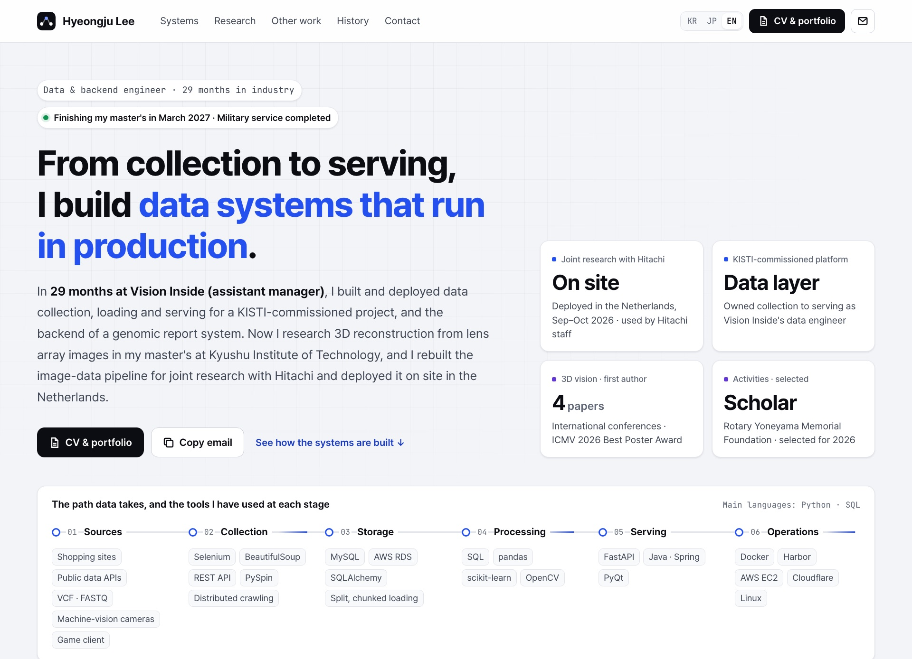
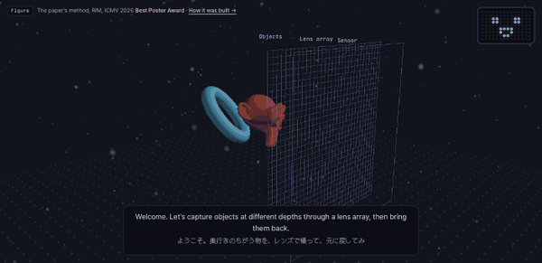

# zoocasso.github.io

Personal site of Hyeongju Lee (이형주), data and backend engineer and 3D vision researcher, in Korean, English and Japanese.

**Open:** [한국어](https://zoocasso.github.io/) · [English](https://zoocasso.github.io/en/) · [日本語](https://zoocasso.github.io/ja/)



## What is on the site

- **Systems as data flows.** The home page shows the work as data-flow diagrams, with results told in words: my own work as solid blue lines with dots flowing along them, other parties' work as grey dashed lines. Clicking a node highlights the data path through it and shows what was done there and by whom.
- **A lens array lab.** The research page opens on a lab in the browser: a 3D scene (or a real Lytro light field) is captured through a pinhole array model, rearranged with RIM, and reconstructed at different depths, with synthesized music and sound.
- **CV and portfolio.** The public PDFs, in Korean and English.



<sub>The lens array lab on the research page, recorded in a headless browser (WebGL): capture through the lens array, elemental images, views, reconstruction at the depth of each object.</sub>

## Key design decisions

- **No framework and no dependencies.** `build.py` assembles the pages with the Python standard library and writes `dist/`; GitHub Actions publishes it to GitHub Pages.
- **Every number has a source.** The numbers shown on the site live in `data/facts.json`, each with the source it was taken from, and pages refer to them as `{{f:key}}`, so a number changes in one place for all three languages.
- **The build checks the content.** It stops if a page uses an unknown fact or partial, shows a phone number or a plain email address, has more or fewer than one `<h1>`, has an image without `alt`, links to a page or anchor that does not exist, or, when built locally, breaks one of my wording rules (kept in a file that is not committed).
- **One structure, three languages.** The Korean, English and Japanese pages share the flow-diagram partials, so a diagram is drawn once.

## Layout

| Path | What it holds |
|---|---|
| `src/pages/ko/`, `src/pages/en/`, `src/pages/ja/` | Page bodies. Each file starts with a `<!--meta {...} -->` comment (title, description, nav) |
| `src/partials/<lang>/` | The flow diagrams, shared by the home page and the detail pages. Pages use `{{inc:flow-kisti}}` |
| `data/facts.json` | Every number shown on the site, with the source it was taken from. Pages use `{{f:key}}` |
| `src/assets/` | `site.css`, `site.js` (email copy, system tabs, flow diagrams, comparison slider, copy buttons), `lab.js` (WebGL2 lab and Web Audio), `rimviz.js` (RIM page viewers) |
| `src/img/`, `src/files/` | Images and the public CV and portfolio PDFs (without phone numbers) |
| `build.py` | Builds `dist/` with the Python standard library and checks it |

## Build and deploy

```
python build.py            # build and check
python build.py --serve    # then serve dist/ on http://127.0.0.1:8000
```

`SITE_DIST=/some/dir` builds somewhere other than `dist/`. Pushing to `main` runs `.github/workflows/deploy.yml`, which builds the site and publishes `dist/` to GitHub Pages.

## Data and credits

The Lytro sample in the lab (`src/img/lytro-*`) comes from occlusions_26 of the Stanford Lytro Light Field
Archive (A. S. Raj, M. Lowney, R. Shah, G. Wetzstein, 2016, http://lightfields.stanford.edu/LF2016.html),
whose "RAW" file is the lenslet image decoded by Lytro's software (ESLF: 541 × 376 lenses, 14 × 14 pixels
each, 16-bit). 128 × 128 lenses at lens (88, 60) are cut without resampling and the central 8 × 8 pixels
of each lens are kept; one white point and gamma 1/2.2 map the values to 8-bit (lossless WebP). Phones get
2 × 2 lenses averaged. `lytro-photo.webp` is the whole picture (central 8 × 8 of each lens averaged) and
`lytro-eslf-zoom.webp` a 32 × 24-lens crop of the lenslet image at 1:1, for the zoom in step 1.
`lytro-layers-*` hold a plane sweep of the same views (25 planes): the shifted-and-averaged image and a
softmax of the view variance across planes, drawn as estimated depth layers and used for click-to-focus.
The archive states no licence; the data is credited wherever it is shown and only a crop is used, for a
non-commercial demonstration.

The Blender sample (`src/img/lab-blender-*`) and the RIM page viewers (`src/img/iccas/`) come from the
ICCAS 2026 scene rendered with the paper's script (`render_multiview.py`, unmodified apart from its
parameters) at 8 × 8 views, 1920 × 1080 per view, 256 samples, plus a depth pass for every view.

- `iccas/v{r}{c}.webp`: the 64 views, the same 1000 × 1000 crop around the objects at native resolution
  (`iccas/s/`: 500 px for phones).
- `iccas/f{ii}.webp`: shift-and-sum of the 64 full-resolution views at depths spaced evenly from
  0.36 to 1.55 m (31 steps).
- `lab-blender-views.webp`, `lab-blender-depth.png`: the views shifted to line up on a plane at 0.28 m
  (so every object's shift per view is positive and grows with distance, as for a lens array), at
  64 lenses, and the per-sample shift from each view's depth pass.
